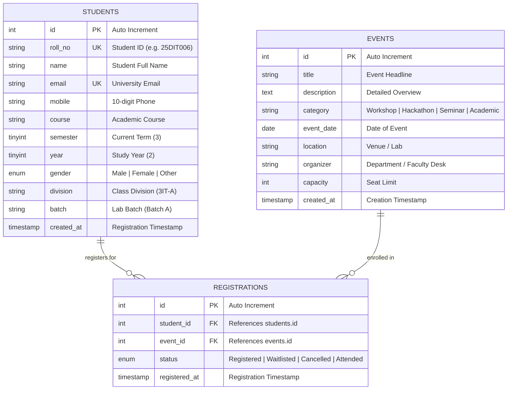

# SYNORA — Database Entity-Relationship (ER) Model
**Academic Context:** CHARUSAT / DEPSTAR Department of Information Technology  
**Program:** B.Tech IT — Semester 3 (Odd Term 2026–27)  
**Milestone:** Practical 8 — MySQL Schema Design & Database Connectivity  

---

## 1. Conceptual Overview

The Synora academic portal database models three core domain entities:
1. **Students:** Enrolled student profiles in the Department of Information Technology.
2. **Events:** University-wide and departmental academic events (workshops, hackathons, seminars).
3. **Registrations:** An associative entity linking students to events they have registered for, resolving the Many-to-Many ($M:N$) relationship into two normalized One-to-Many ($1:N$) relationships.

---

## 2. Mermaid ER Diagram

---

## 3. Entity & Attribute Dictionary

### Table: `students`
Represents registered students in DEPSTAR Information Technology.

| Column | Type | Constraints | Description |
| :--- | :--- | :--- | :--- |
| `id` | `INT UNSIGNED` | `PRIMARY KEY`, `AUTO_INCREMENT` | Unique internal surrogate identifier |
| `roll_no` | `VARCHAR(20)` | `NOT NULL`, `UNIQUE` | Official university roll number (e.g., `25DIT006`) |
| `name` | `VARCHAR(100)` | `NOT NULL` | Student full legal name |
| `email` | `VARCHAR(120)` | `NOT NULL`, `UNIQUE` | Official CHARUSAT student email address |
| `mobile` | `VARCHAR(15)` | `NOT NULL` | 10-digit mobile contact number |
| `course` | `VARCHAR(60)` | `NOT NULL`, Default `'B.Tech IT'` | Enrolled academic program |
| `semester` | `TINYINT UNSIGNED` | `NOT NULL`, Default `3` | Current semester of study |
| `year` | `TINYINT UNSIGNED` | `NOT NULL`, Default `2` | Academic year (1 to 4) |
| `gender` | `ENUM('Male','Female','Other')` | `NOT NULL` | Demographic classification |
| `division` | `VARCHAR(10)` | `NOT NULL`, Default `'3IT-A'` | Classroom division |
| `batch` | `VARCHAR(10)` | `NOT NULL`, Default `'Batch A'` | Practical laboratory batch allocation |
| `created_at`| `TIMESTAMP` | `NOT NULL`, Default `CURRENT_TIMESTAMP` | Account creation timestamp |

### Table: `events`
Represents campus academic and co-curricular events.

| Column | Type | Constraints | Description |
| :--- | :--- | :--- | :--- |
| `id` | `INT UNSIGNED` | `PRIMARY KEY`, `AUTO_INCREMENT` | Unique event identifier |
| `title` | `VARCHAR(150)` | `NOT NULL` | Event headline title |
| `description` | `TEXT` | `NOT NULL` | Full description of topics covered |
| `category` | `VARCHAR(50)` | `NOT NULL` | `Workshop`, `Hackathon`, `Seminar`, `Academic`, `Cultural` |
| `event_date` | `DATE` | `NOT NULL` | Scheduled date of event execution |
| `location` | `VARCHAR(100)` | `NOT NULL` | Lab, classroom, or auditorium venue |
| `organizer` | `VARCHAR(100)` | `NOT NULL` | Organizing faculty mentor or student club |
| `capacity` | `INT UNSIGNED` | `NOT NULL`, Default `100` | Maximum participant seats |
| `created_at`| `TIMESTAMP` | `NOT NULL`, Default `CURRENT_TIMESTAMP` | Record timestamp |

### Table: `registrations`
Associative table resolving the Many-to-Many relationship between students and events.

| Column | Type | Constraints | Description |
| :--- | :--- | :--- | :--- |
| `id` | `INT UNSIGNED` | `PRIMARY KEY`, `AUTO_INCREMENT` | Unique registration record identifier |
| `student_id` | `INT UNSIGNED` | `NOT NULL`, `FOREIGN KEY` | Foreign key referencing `students(id)` |
| `event_id` | `INT UNSIGNED` | `NOT NULL`, `FOREIGN KEY` | Foreign key referencing `events(id)` |
| `status` | `ENUM` | Default `'Registered'` | Current status (`Registered`, `Waitlisted`, `Cancelled`, `Attended`) |
| `registered_at`| `TIMESTAMP` | `NOT NULL`, Default `CURRENT_TIMESTAMP` | Submission timestamp |

---

## 4. Referential Integrity & Constraints

1. **Foreign Key Cascades:**
   - `CONSTRAINT fk_registrations_student FOREIGN KEY (student_id) REFERENCES students(id) ON DELETE CASCADE ON UPDATE CASCADE`
   - `CONSTRAINT fk_registrations_event FOREIGN KEY (event_id) REFERENCES events(id) ON DELETE CASCADE ON UPDATE CASCADE`
   - If a student or event record is deleted, associated registrations are cleanly cascaded without leaving orphaned records.
2. **Composite Uniqueness:**
   - `UNIQUE KEY unique_student_event (student_id, event_id)` prevents the same student from registering more than once for the same event.

---

## 5. Database Normalization Analysis

- **First Normal Form (1NF):**
  - All attributes contain atomic, scalar values (no multivalued repeating fields or comma-separated lists).
  - Every table has a primary key (`id`).
- **Second Normal Form (2NF):**
  - All non-key attributes are fully functionally dependent on the entire primary key.
  - The associative table uses surrogate key `id` with composite unique constraint on `(student_id, event_id)`.
- **Third Normal Form (3NF):**
  - No transitive dependencies exist. Attributes depend directly on the primary key alone (e.g., student name and contact depend on `students.id`, not `registrations.id`).

---

## 6. Practical 8 vs Practical 9 Boundary

This database model intentionally supports the **Practical 8 scope**:
- Entity-Relationship modeling
- Relational schema creation and foreign key constraints
- PHP PDO connection and prepared statement queries

Password hashing, user authentication, login session tables, and role-based access control are strictly excluded as they belong to Practical 9.
